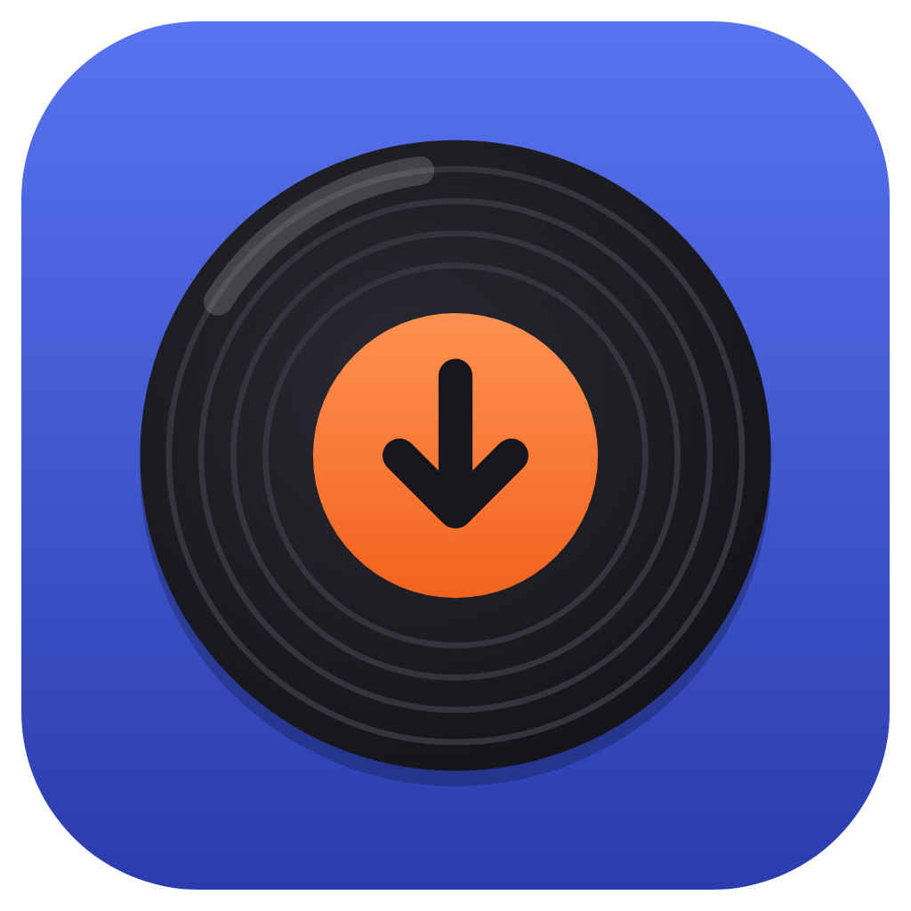
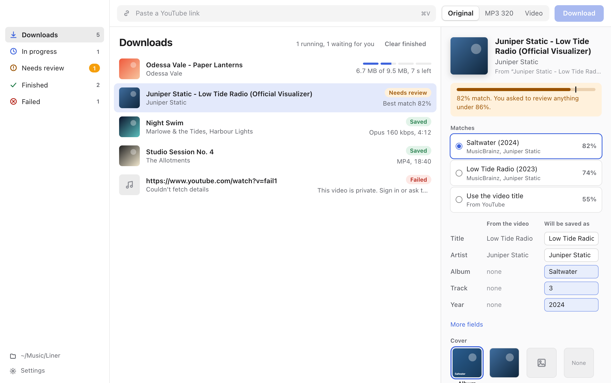
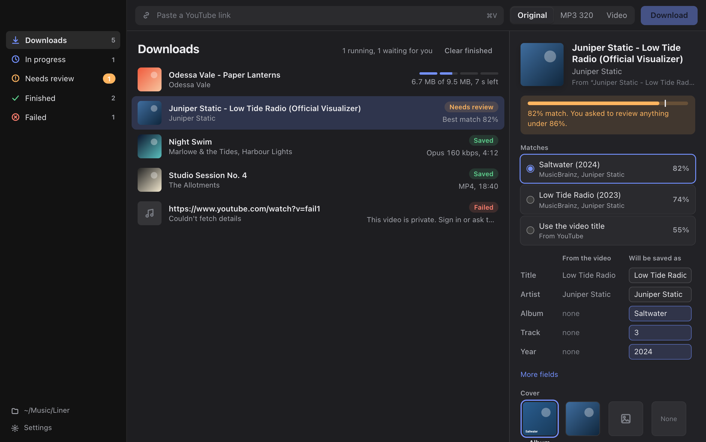
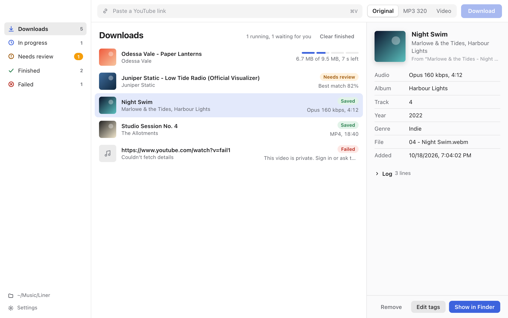

<p align="center"></p>

# Liner

A desktop app for macOS and Windows that saves a YouTube video as high-quality audio or as an MP4, finds the right song tags on MusicBrainz, adds cover art, and files everything into a tidy music folder. The name comes from liner notes: the credits and artwork that come with an album, which is the part Liner fills in for you.



<details>
<summary>Dark mode and a finished download</summary>




</details>

Screenshots use made-up artists and songs.

## What it does

- **Paste a link and go.** Paste anywhere in the window, drop a link on it, or press ⌘⇧V (Ctrl+Shift+V on Windows) to paste and start in one step.
- **Pick the format per download.** Original (the best audio YouTube has, untouched), MP3 320, or Video (MP4).
- **Live progress.** Each download shows its step (fetch, download, match, tag), size and time left.
- **Tags you can trust.** Matches come from MusicBrainz. When the best match is below your threshold, the download waits in **Needs review**, where you see what the video title says next to what will be saved, and can fix any field.
- **Cover art.** Album covers from the Cover Art Archive, the video frame, or your own image.
- **An organised library.** Audio goes to `Artist/Album/NN - Title.ext`, videos to `Videos/Title.mp4`, under a folder you choose.
- **Stays working.** YouTube changes often, so the app checks for a new yt-dlp once a day and updates it for you.
- **Light and dark**, native window styles on macOS and Windows 11.

Single videos only for now. Playlists and channels are not supported yet.

## Install

Download the latest `.dmg` (macOS) or `.exe` (Windows) from [Releases](https://github.com/Omaaarkhan/Liner/releases).

The builds are not signed with an Apple Developer ID or a Windows certificate yet, so the first launch needs one extra step:

- **macOS:** drag Liner to Applications and open it. When macOS says it can't verify the app, click **Done**, then go to **System Settings → Privacy & Security**, scroll down and click **Open Anyway** next to Liner. On macOS 14 and earlier you can instead right-click the app and choose **Open**, then **Open** again.
- **macOS, if it says "Liner is damaged and can't be opened":** this comes from the quarantine flag your browser adds to downloads (the first 0.2.1 Mac builds also had an incomplete signature). Clear it in Terminal, then open the app normally:

  ```bash
  xattr -cr /Applications/Liner.app
  ```
- **Windows:** if SmartScreen appears, choose **More info**, then **Run anyway**.

## Build from source

You need Node.js 20 or newer.

```bash
npm install
npm run dev
```

`npm run dev` downloads yt-dlp, prepares ffmpeg, and opens the app with live reload.

| Command | What it does |
| --- | --- |
| `npm run dev` | Run the app in development |
| `npm run dev:ui` | Run only the interface in a browser with sample data (no Electron needed) |
| `npm test` | Run the tests |
| `npm run lint` | Type-check everything |
| `npm run package:mac` | Build a `.dmg` and `.zip` for this Mac's architecture into `apps/desktop/release/` |
| `npm run package:win` | Build a Windows installer (run on Windows) |

Installers for every platform are built by GitHub Actions when a `v*` tag is pushed (see `.github/workflows/release.yml`). Each platform builds on its own OS because the bundled tools are prepared for the machine doing the build.

### Using your own yt-dlp or ffmpeg

The app bundles both. To use other copies, set these before launching:

```bash
YAR_FFMPEG_PATH=/path/to/ffmpeg
YAR_YTDLP_PATH=/path/to/yt-dlp
```

## How it works

1. yt-dlp fetches the video's details once and saves them, so the download step doesn't repeat the work.
2. The best audio stream (or video and audio for MP4) downloads with progress reported back to the window.
3. The video title is parsed into artist and title and searched on MusicBrainz.
4. If the best match clears your threshold it's applied automatically; otherwise the download waits for you.
5. ffmpeg writes the tags and cover art, and the file moves into your library.

Settings and history live in the app's data folder (`~/Library/Application Support/@audio-ripper/desktop` on macOS, `%APPDATA%\@audio-ripper\desktop` on Windows).

## Repository layout

- `apps/desktop`: Electron main process, preload bridge, React interface, packaging config and icons.
- `packages/core`: download pipeline, tag matching, tagging, library placement, history.
- `packages/shared`: shared TypeScript types.
- `packages/tests`: Vitest tests.

See [CONTRIBUTING.md](CONTRIBUTING.md) to get involved.

## License

MIT for this project's code. The bundled yt-dlp and FFmpeg keep their own licenses; see [THIRD_PARTY_NOTICES.md](THIRD_PARTY_NOTICES.md).

## Use it responsibly

Only download media you have the right to save. You're responsible for following YouTube's terms of service and the copyright law where you live. This project is not affiliated with or endorsed by YouTube or Google.
